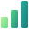

# Icons

How PC Companion's own icons look: the app icon, and the icon that names each feature. A new icon starts from the drawings in [`icons/`](icons/), follows this page, and is shown to the maintainer before it's used.

   

## Where icons appear

| Where | Icon | Size at 100% display scale |
|---|---|---|
| Taskbar, Start menu, Alt+Tab, Settings > Apps, File Explorer | App icon, from `src/PCCompanion.App/Assets/PCCompanion.ico` | 16 to 256 pixels; the file has 16, 20, 24, 32, 40, 48, 64 and 256 |
| The settings window's title bar, and the PC Companion icon in the notification area | App icon | 16 |
| Notifications, which come from the PC Companion icon | App icon | 32 |
| Installer images and the website | App icon; `scripts/installer-images.ps1` draws the images, and `website/icon.png` is the 256-pixel image | 256 |
| Navigation pane | Feature icon; Home and General keep their Segoe Fluent Icons glyphs, 16 pixels high in the same space | 20 |
| Home cards | Feature icon | 20 |
| A feature page's header | Feature icon | 32 |
| Setting cards, buttons and menus inside a page | Segoe Fluent Icons glyph; see [Inside pages](#inside-pages) | 16 to 20 |

- In the navigation pane, on Home and in the header, the settings app shows a feature's drawing when its entry in `FeatureCatalog` names one (`DrawnIcon`), and otherwise its Segoe Fluent Icons glyph, `FeatureInfo.Glyph`.
- `website/icon.png` and the website's screenshots show the app icon of the latest release; see [Website](../development/website.md).

## App icon

- Two rounded squares: a large blue one at the bottom left, the PC, and a smaller amber one at the top right, the companion that adds to it. The amber square is tilted 10° clockwise and lies over the blue one's top-right corner, and where they overlap the icon is light cream.
- Abstract: no object, letters or text.
- Drawn on a 48-pixel grid, and by hand at 64, 40, 32, 24, 20 and 16 pixels, with the blue square's edges on whole pixels. Other sizes, such as 256 pixels, scale the 48-pixel drawing.

| Size | Blue square: x, y, side, corner radius | Amber square: center, side, corner radius |
|---|---|---|
| 64 | 4, 17, 43, 12 | (45, 19), 29.5, 8.75 |
| 48 | 3, 13, 32, 9 | (33.5, 14.5), 22, 6.5 |
| 40 | 2, 11, 27, 7.5 | (27.75, 12.25), 18.5, 5.5 |
| 32 | 2, 9, 21, 6 | (22, 10), 14.5, 4.25 |
| 24 | 1, 7, 16, 4.5 | (16.5, 7.5), 11, 3.25 |
| 20 | 1, 5, 14, 4 | (14, 6), 9, 2.7 |
| 16 | 1, 4, 11, 3 | (11.5, 4.5), 7, 2 |

- Colors: the blue square is `#5A86FF` → `#3940D6`, with a white highlight over its top-left 60% that fades from 28% to 0% opacity; the amber square is `#FFD25E` → `#FF8A3C`; and the overlap is `#FFF6E6` → `#FFD9B0`. Each runs from the top left of its shape to the bottom right.
- Don't put it on a plate or in a frame, outline it, recolor it, change its angle or proportions, mirror it, or add shapes or text. Nothing in it may resemble the Windows logo or other Microsoft marks, such as four squares in a grid.
- The one-color version fills both squares and cuts out their overlap.

## Feature icons

- One familiar object that stands for what the feature works on, drawn large: it fills almost the whole square, so the icon reads without its name.
- At most one second object, at the bottom right, for what the feature adds or does, in a color of its own, such as an orange bolt or a red stop sign. Input Language per App is the one exception: its window has three speech bubbles round it, one for each language, and the 文 bubble is orange, which keeps the icon warm among the blues.
- Two or three parts in all, but for that exception. Small details only where they name the object, such as the lines on a clipboard's paper; nothing that disappears at 20 pixels.
- Depth from tones, not lines: an object is two or three flat planes in tones of its color, deeper for parts at the back and edges, such as a title bar or a keycap's sides, and lighter for faces in front. A round object can instead be lit from the left, as the mouse of Middle-Click Paste is: each of its parts split down the middle, lighter on the left and deeper on the right. No outlines, highlights, shadows or perspective.
- Symbols on an object, such as a pointer, an arrow, an eye or a letter, are plain white.
- No gray, which makes an icon look dull: parts that are often gray, such as a keyboard or a monitor's frame, are in a deep tone of the icon's color, and paper and plastic are white with a tint of blue.
- Letters, such as the 文, A and ع of Input Language per App, are drawn as strokes, not set in a font.
- Features of a kind share their second object: the bolt of Clipboard Actions and Drive Actions, an action, and the bookmark of Network Profiles and Display Profiles, a saved profile.
- Color is never the only thing that tells two icons apart: each has its own object.

| Feature | Object | Second object | Color |
|---|---|---|---|
| Hot Corners | A screen, its top-left corner lit, with a white pointer heading for it | | Green |
| Lock Keys | A keycap with the white Caps Lock arrow and bar | | Violet |
| Input Language per App | An app window | Three speech bubbles round it, with a white 文, A and ع: the 文 bubble orange, the A bubble in the main tone and the ع bubble in the deepest | App blue |
| App Windows | Three windows stacked, deepest at the back and lightest in front | | Sky |
| Minimize to Tray | A window with a white arrow down to the taskbar, which has a tray icon | | Green |
| Hide Apps | A window with a white eye, crossed out | | Violet |
| Drop-down Apps | A screen with a panel hanging from its top edge, with a white chevron | | App blue |
| Title Bar Actions | A window with a blue title bar | A blue mouse with an orange wheel | Sky |
| End App | An app window | A red stop sign with a white bar | Violet |
| System Meters | Three bars, from light and short to deep and tall | | Green |
| Dynamic Wallpaper | A picture of mountains, its sky split into day with a white sun and night with a white moon | | Sky |
| Clipboard Actions | A clipboard | An orange bolt | App blue |
| Middle-Click Paste | A mouse lit from the left, with an orange wheel | | Violet |
| Network Profiles | A Wi-Fi symbol | An orange bookmark | Sky |
| Folder Rules | A yellow folder | A blue funnel | Yellow, with an app blue funnel |
| Drive Actions | A USB stick | An orange bolt | Green |
| Display Profiles | A monitor | An orange bookmark | App blue |

### Colors

- Four color families, each a gradient between two neighboring hues, which keeps the icons rich without looking busy: sky, from cyan to blue; the app icon's blue; violet, toward indigo; and green, toward teal. The orange is the app icon's amber, so the feature icons belong with it.
- Each icon is in one family, and icons next to each other in the navigation pane are in different ones; the table above says which.
- Another color is used where an object has one people know it by, such as a yellow folder or a red stop sign. It's made to sit with the families and the amber: as warm or cool, as bright and as soft as they are, never neon or muddy, with a gradient between neighboring hues. No pink. A new color goes into the table below when it's first used.

| Tone | Used for | Sky | App blue | Violet | Green |
|---|---|---|---|---|---|
| Light | Faces in front and light planes | `#9DEAFF` → `#58AAFE` | `#97B3FF` → `#7799FF` | `#BD96FF` → `#9C6CFE` | `#B0F098` → `#64DE89` |
| Main | An object's body | `#29C3FF` → `#2764E7` | `#5A86FF` → `#4A6BF0` | `#9C6CFE` → `#7A41DC` | `#52D17C` → `#22918B` |
| Deep | Title bars and parts at the back | `#0094F0` → `#2052CB` | `#4A5FE8` → `#3940D6` | `#885EDB` → `#5B2AB5` | `#20AC9D` → `#1A7F7C` |
| Deepest | The darkest parts, such as a keycap's sides, a taskbar or a monitor's frame | `#0067BF` → `#003580` | `#3940D6` → `#2B2FA8` | `#6D37CD` → `#3B148A` | `#1A7F7C` → `#0E5C5A` |

| Color | Used for | Fill |
|---|---|---|
| Paper | Paper, plastic and a window's content | `#F8FAFF` → `#DCE6FF` |
| Orange | Second objects; it's the app icon's amber | `#FFD25E` → `#FF8A3C` |
| Yellow | Folders: the front, then the back | `#FFE06B` → `#FAB500`, `#FFA43D` → `#E67505` |
| Red | Stop signs | `#F83F54` → `#CA2134` |
| White | Symbols on an object | `#FFFFFF` |

- Every fill runs from the top left of its shape to the bottom right (`x1="0" y1="0" x2="1" y2="1"`).
- A second object never lies on its own color: it's orange or red, or a family other than the one under it, as the blue mouse of Title Bar Actions on its window's paper and the blue funnel of Folder Rules on the yellow folder are.
- At least half of each icon has a contrast of 2:1 or more against light backgrounds (`#F3F3F3`), and 3:1 or more against dark ones (`#202020`). The lower bar on light backgrounds keeps the light tones of sky and green: a feature icon always appears next to the feature's name, so it's never the only way to tell features apart, and high contrast themes show the one-color versions.
- Paper, orange and yellow have about 2:1 or less on light backgrounds, so they're never half of an icon. The exception is Folder Rules: folders are yellow in File Explorer, so its folder is yellow, and its funnel blue.

### Shapes and sizes

- Each icon is drawn at 32 and 20 pixels, each on its own: the 20-pixel drawing leaves out details and enlarges what must stay readable, such as a pointer or a letter, instead of scaling the 32-pixel drawing down.
- At 32 pixels the object reaches to 1 to 1.5 pixels from the edges. At 20 pixels it leaves 2 pixels round it, so that the rows of the navigation pane, where icons stand one above the other, stay light. A tall or wide object fills the space in its long direction and is centered in the other.
- At both sizes, straight edges are on whole pixels, so they stay sharp.

| | 32 px | 20 px |
|---|---|---|
| Space round the object | 1 to 1.5 | 2 |
| An object's corner radius | 2 to 2.5 | 1.5 |
| A small part's corner radius | 1 to 1.5 | 0.5 to 1 |
| A white symbol's stroke | 2 to 2.6 | 1.2 to 1.6 |
| A cut where a white symbol crosses another | 1.2 to 1.5 | 0.9 to 1 |

- A second object lies on the first without a gap, since its color sets it apart. Where a white symbol crosses another, such as the slash through the eye of Hide Apps, the one under it is cut, so the two stay apart.
- Icons aren't mirrored in right-to-left layouts.

## High contrast

- Each icon has a one-color version for high contrast themes, in the theme's text color: the same shapes, with paper and white symbols cut out, so they show the background, and everything else filled.
- Planes of one object that meet, such as stacked windows or a title bar on its window, are kept apart by a cut as wide as in the cut row of [Shapes and sizes](#shapes-and-sizes), and so is a second object from the first. A split that is only light, such as down the body of Middle-Click Paste's mouse, gets no cut; the split between its two buttons does.
- No gradients, and nothing added or left out compared with the color version.

## Inside pages

- Setting cards, buttons, menus and notes use Segoe Fluent Icons glyphs, in one color, which follow the theme and high contrast, as Windows Settings does. Color drawings are only for the app icon and the icons that name a feature.

## Files

- [`icons/`](icons/) has the approved drawings as SVG: `<name>-<size>.svg`, and `<name>-<size>-mono.svg` for the one-color version, such as `hot-corners-20.svg` and `hot-corners-20-mono.svg`. `<name>` is the feature's name in lowercase with hyphens, or `app`.
- `scripts/icon-drawings.ps1` writes them from each icon's shapes at each size, and works out the cuts and the one-color versions. To change an icon or add one, change or add its shapes there, run it, then `app-icon.ps1` or `feature-icons.ps1`, and look at the result.
- `scripts/feature-icons.ps1` makes the settings app's images of the feature icons in `src/PCCompanion.App/Assets/Icons`: a PNG of the color and the one-color version for each size an icon is shown at, 20 and 32 pixels, at 100%, 125%, 150% and 200% display scale, from the drawing closest in size. It records the drawings it used in `drawings.txt`, and `PCCompanion.Architecture.Tests` fails when a drawing has changed since.
- `scripts/app-icon.ps1` makes `PCCompanion.ico` from the `app-<size>.svg` drawings; see [Packaging](../development/packaging.md).
- They use only what Windows' SVG renderer, Direct2D, [supports](https://learn.microsoft.com/en-us/windows/win32/direct2d/svg-support), which WinUI's `SvgImageSource` uses: `svg`, `defs`, `g`, `rect`, `path`, `linearGradient`, `stop` and `clipPath`, with attributes rather than `style` or CSS. Direct2D ignores `mask`, `symbol`, `use`, `filter` and `text`.
- Coordinates are in pixels, with a `viewBox` the size of the icon.
- A cut in a color drawing, such as the one round the slash of Hide Apps, is a `clipPath` on the shapes under it: the whole icon minus the cut's outline, as one path with `clip-rule="evenodd"`. The outline is the shape grown by half its stroke plus the cut, with round corners.
- A one-color version is one path with `fill="currentColor"`, with the cutouts as holes. The script works it out with the shape geometry of WPF, which comes with Windows: it takes the white symbols, the paper and the cuts out of the shapes.

## Checklist

Before an icon is proposed:

- It's one large object, with at most one second object at the bottom right, in two or three parts, and reads at 20 pixels without its name.
- It has no outlines, highlights, shadows or gray, and its colors are the ones in [Colors](#colors), in the color its row of the icon table gives it.
- It's drawn at 32 and 20 pixels, with straight edges on whole pixels at 20, and each size has a one-color version.
- It was looked at at its real sizes and enlarged, on light, dark and high contrast backgrounds, next to the icons in [`icons/`](icons/): in the navigation pane, on a Home card and in a page header.
- Its files are written by `scripts/icon-drawings.ps1`, so they use only what Direct2D supports.
